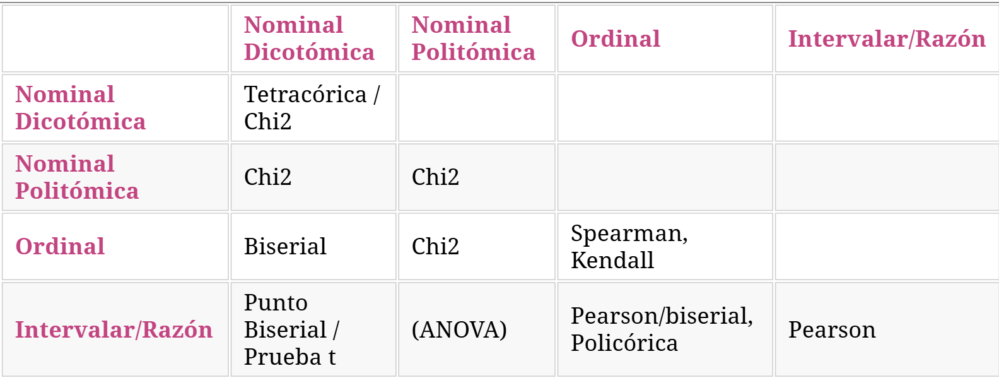

Esta guía está diseñada para acompañar el estudio para la prueba 2 del curso Estadística Correlacional.

# Conceptos teóricos de la asociación en Estadística
## Entendiendo la covarianza y la correlación
La covarianza es una medida de **asociación** lineal entre variables basada en la variabilidad de cada una de ellas. Su valor no es interpretable directamente ya que la magnitud depende de las unidades de las variables. Por esta razón, ocupamos la correlación, la cual es la medida estandarizada de la covarianza.

Por ejemplo, si calculamos la covarianza entre un índice de apoyo a la democracia (0-100 puntos) e ingreso mensual bruto (110.000-3.000.000 CLP), obtendremos un resultado inflado por la magnitud de ceros que tiene el ingreso bruto la cual no se puede interpetar. Por esta razón, ocupamos la correlación de Pearson que divide la covarianza por el producto de las desviaciones estándar de ambas variables, la métrica se estandariza y obtendremos un valor entre -1 a 1.

## Tipos de correlación

{#fig-covarianza width="70%"}

La tabla resume que tipo de correlación ocuparemos según el tipo de variables. Es importante tener en cuenta que la justificación del tipo de correlación que usaremos se sustenta en la **naturaleza de las variables**.


## Elementos de las correlaciones

En general analizaremos los siguientes componentes a partir de los resultados que obtenemos:

- **Dirección:** determinada por el signo del valor, negativa o positiva.

- **Intensidad de efecto:** siguiendo los criterios de Cohen: 
  - Muy pequeño ($r<0.1$).
  - Pequeño ($0.1<r<0.3$).
  - Moderado ($0.3<r<0.5$).
  - Grande ($r>0.5$).

- **Significancia:** aquí retomamos los contenidos de inferencia estadística, con un $p<0.05$ se considera que los resultados son estadísticamente significativos (se rechaza la hipótesis nula de no asociación entre variables).

Recordar siempre que correlación NO IMPLICA causalidad!

## Matriz de correlación
Una matriz de correlación se conforma cuando se representa simultáneamente más de un par de asociaciones bivariadas.

## Tratamiento de casos perdidos
- Listwise (eliminación por lista): Si un caso tiene un dato perdido en cualquiera de las variables analizadas, se elimina el caso completo. Se suele recomendar cuando los datos perdidos representan menos del 10% de la muestra total (y se asumen perdidos al azar).
- Pairwise (eliminación por pares): Muy útil en matrices de correlaciones. Se eliminan los casos perdidos solo para el cálculo del par específico de variables afectadas. Esto permite maximizar el tamaño de la muestra ($N$) disponible para cada cruce.

## Chi cuadrado
Chi cuadrado permite rechazar o no la hipótesis nula de independencia (ausencia de asociación) entre variables categóricas (nominales u ordinales) utilizando tablas de contingencia. Dado que su magnitud depende fuertemente del tamaño de la muestra, no sirve para medir la fuerza de la asociación por sí solo. Para eso ocupamos medidas de tamaño del efecto:

- Coeficiente Phi ($\phi$): Para variables binarias (tablas de 2x2). Va de -1 a 1 y se interpreta similar a Pearson en fuerza. Ojo: El sentido (positivo o negativo) dependerá arbitrariamente de cómo estén codificadas (0 y 1) las categorías en la tabla.

- V de Cramer ($V$): Para tablas mayores a 2x2. Va de 0 a 1 (solo indica fuerza, no dirección). Para interpretar si la fuerza es débil, moderada o fuerte, se utilizan los criterios de Cohen, los cuales varían según los grados de libertad de la tabla.

# Estadística bivariada en R
Ocuparemos las siguientes librerías:
```{r}
pacman::p_load(tidyverse, # Manipulacion datos
               sjPlot, # Graficos y tablas
               sjmisc, # Descriptivos
               corrplot, # Correlaciones
               psych, # Test estadísticos
               kableExtra) # Tablas

options(scipen = 999) # para desactivar notacion cientifica
rm(list = ls()) # para limpiar el entorno de trabajo
```

## Correlaciones en R
Antes de empezar, desarmemos la estructura de la función principal. Para este ejemplo, usaremos la base de datos data y cruzaremos v1 y v2.

- cor.test(): Es la función que ejecuta la prueba de correlación.

- data$v1: El signo peso funciona como una llave. Le dice a R: "Entra a la base de datos y extrae únicamente v1".

- method = : Aquí declaramos qué coeficiente usar según la naturaleza (nivel de medición) de nuestras variables.

Veamos el código en acción usando el método de Pearson:
```{r}
#| eval: false
cor.test(data$v1, data$v2, method = "pearson")
```

Si las variables fueran de rango u ordinales, usaríamos Spearman o Kendall. Fíjate que en Spearman agregamos exact = FALSE. Esto sirve para que R no arroje advertencias si encuentra "empates" (personas con los mismos años de estudio).

```{r}
#| eval: false
cor.test(basededatos$variable1, basededatos$variable2, 
         method = "spearman", 
         exact = FALSE)
```

```{r}
#| eval: false
cor.test(basededatos$variable1, basededatos$variable2,
         "two.sided", 
         "kendall")
```

## Gráficos en R
Para visualizar esta misma relación, creamos un gráfico de dispersión (nube de puntos). Al usar la librería sjPlot, la sintaxis cambia ligeramente: le entregamos la base de datos completa (data = data) y luego le indicamos qué variables graficar en cada eje.

```{r}
#| eval: false
sjPlot::plot_scatter(data = data, x = v1, y = v2)
```

## Matrices de correlación y casos perdidos en R
Cuando queremos analizar varias variables al mismo tiempo construimos una matriz.

Primero, preparamos un subconjunto de datos usando la pipa (%>%), que funciona como un embudo y se lee como "entonces", y luego diagnosticamos cuántos datos perdidos (NA) tenemos.

```{r}
#| eval: false
datos_matriz <- data %>% 
  dplyr::select(v1, v2, v3)
sum(is.na(data))

colSums(is.na(data))
```

Una vez que sabemos cuántos NA tenemos, generamos la matriz con sjPlot:

```{r}
#| eval: false
sjPlot::tab_corr(data,
                 na.deletion = "pairwise", # especificamos tratamiento NA
                 triangle = "lower")   

sjPlot::tab_corr(data,
                 na.deletion = "listwise", # espeficicamos tratamiento NA
                 triangle = "lower")   
```

- na.deletion = "pairwise" o "listwise": eligimos el tratamiento de los casos perdidos

- triangle = "lower": Como las matrices son un espejo (la correlación entre A y B es igual a la de B y A), este parámetro oculta la mitad superior repetida y la diagonal de 1s.

## Tablas de Contingencia en R
Para evaluar si existe asociación entre variables categóricas, generamos una tabla de contingencia.

```{r}
#| eval: false
data %>%
  sjPlot::sjtab(v1,
                v2,
                show.row.prc = TRUE, # porcentaje fila
                show.col.prc = TRUE, # porcentaje columna
                )
```

Para calcular solo chi cuadrado se hace a través de este código:
```{r}
#| eval: false
chi_results <- chisq.test(data$v1, data$v2)
chi_results
```

# Ejercicio
A partir de la siguiente base de datos, responda las siguientes preguntas:
```{r}
pacman::p_load(tidyverse, # Manipulacion de datos
               car, # Recodificar
               sjPlot, # Tablas y graficos
               sjmisc, # Descriptivos
               kableExtra, # Tablas
               psych, # Bivariados
               corrplot, # Graficos correlacioj
               broom) # Varios

options(scipen = 999) # para desactivar notacion cientifica
rm(list = ls()) # para limpiar el entorno de trabajo

load(url("https://github.com/cursos-metodos-facso/datos-ejemplos/raw/refs/heads/main/dataset4.RData")) # base de datos a utilizar
```

## Descriptivo:
1) Identifique las variables con sus respectivos niveles de medición (dicotómica, nominal, ordinal, numérica). Si son cuantitativas, mencione el rango mínimo y máximo de los valores; si son categóricas, identifique la proporción de respuestas por categoría.
2) Identifique la cantidad de datos perdidos por variables, ¿cuál es la variable con mayor cantidad de casos perdidos?

## Asociación:
3) ¿En qué medida se relacionan los ingresos (en pesos) de las personas con sus niveles de apoyo a la democracia?
  a) ¿Qué prueba estadística nos permite responder la pregunta?¿por qué?
  b) A partir de los resultados, interprete: dirección, intensidad de efecto y significancia estadística. Recuerda que el análisis que redactes debe ser entendido por cualquier persona!
  c) Grafique la asociación.

## Matriz de correlación:
4) Construya una matriz de correlación con las variables apoyo a la democracia, ingresos e ingresos recodificados.
  a) ¿Qué tipo de tratamiento de datos perdidos deberíamos usar?
  b) ¿Qué significan los asteriscos en los resultados?¿Qué pasa si no hay asteriscos en un resultado?

## Asociación 2:
5) ¿En qué medida se relacionan los ingresos recodificados de las personas con el sexo?
  a) ¿Qué prueba estadística nos permite responder la pregunta?¿por qué?
  b) Construya una tabla, matriz o gráfico que de cuenta de la asociación.
  c) A partir de los resultados, interprete. ¿Qué coeficiente adicional se tuvo que ver para analizar los resultados?

# Respuestas
Comenzamos con los descriptivos de las variables, recuerden que, dependiendo del nivel de medición de las variables, calcularemos ciertos valores o no:

```{r}
summary(dataset4$apoyo_dem)
summary(dataset4$ingresos)
frq(dataset4$sexo)
frq(dataset4$ingresos_rec)
```

Debido a que ambas variables son cuantitativas, usaremos correlación de Pearson:
```{r}
cor.test(dataset4$ingresos, dataset4$apoyo_dem, method = "pearson")
```

Para graficar, usamos una nube de puntos:

```{r}
sjPlot::plot_scatter(data = dataset4, x = ingresos, y = apoyo_dem)
```

Se empleó el coeficiente de correlación de Pearson debido a la naturaleza de las variables, en tanto los ingresos en peso y el nivel de apoyo a la democracia corresponden a variables númericas de razón. El coeficiente da cuenta de una relacion positiva y grande, siguiendo los criterios de Cohen (1988) ($r = 0.79$). Es decir, a medida que aumentan los ingresos de las personas, también aumentan sus niveles de apoyo a la democracia. La relación es estadísticamente significativa ($p < 0.001$), por ende es posible rechazar $H_0$ sobre no asociación entre variables, entregando evidencia a favor de una relación entre ambas variables con un 99.9% de confianza.

A continuación, para crear la matriz de correlación, identificamos los casos perdidos:

```{r}
datos_matriz <- dataset4 %>% 
  dplyr::select(apoyo_dem, ingresos, ingresos_rec)
sum(is.na(datos_matriz))

colSums(is.na(datos_matriz))
```

Ingresos e ingresos recodificado tienen 150 NAs de 1000 casos, 15% de los casos. Por lo tanto, ocuparemos pairwise (más del 10%).

```{r}
sjPlot::tab_corr(datos_matriz,
                 na.deletion = "pairwise", # espeficicamos tratamiento NA
                 triangle = "lower")   
```

Los tres asteriscos en este caso refieren a que todas las correlaciones calculadas son estadísticamente significativas con un 99.9% de confianza. Si no hay asteriscos significa que la significancia es menor al 95% de confianza ($p > 0.05$), por lo tanto no se puede rechazar la hipótesis nula de no asociación.

Por último, se usa chi cuadrado ya que se quiere medir la asociación entre dos variables categóricas. Construimos una tabla de contingencia.

```{r}
dataset4 %>%
  sjPlot::sjtab(sexo,
                ingresos_rec,
                show.row.prc = TRUE, # porcentaje fila
                show.col.prc = TRUE, # porcentaje columna
                )
```

Para interpretar la intensidad de la asociación, observamos el coeficiente V de Cramer, el cual se utiliza en tablas mayores a 2x2. Siguiendo los criterios de Cohen (1988), el valor obtenido (V = 0.668) da cuenta de una relación grande entre el sexo y el nivel de ingresos. Además, esta relación es estadísticamente significativa ($p < 0.001$), por lo que es posible rechazar la hipótesis nula ($H_0$) de no asociación, entregando evidencia a favor de una relación entre ambas variables con un 99.9% de confianza.